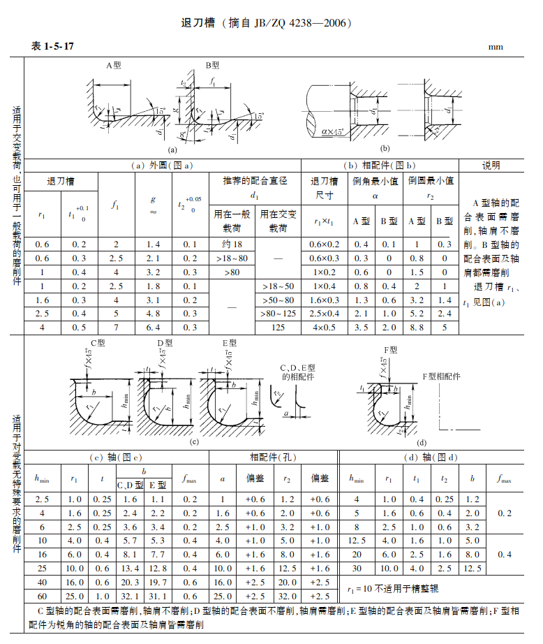

# 退刀槽选型：A～F型用途与查表方法

[返回主题百科](README.md) · [知识库首页](../README.md) · [查看原表图片](../assets/mechanical-design/relief-groove-table.png)

| 信息 | 内容 |
| --- | --- |
| 主题 | 机械设计、轴类零件、磨削退刀槽 |
| 建立日期 | 2026-11-05 |
| 更新日期 | 2026-11-05 |
| 直接来源 | 本次提供的手册截图：表1-5-17《退刀槽》 |
| 图中注明的依据 | 摘自JB/ZQ 4238—2006 |
| 单位 | 原表尺寸单位为mm |
| 条目状态 | 原表读图与选型方法整理，具体零件待输入参数 |

本条目说明这张表的选型与查表方法。标为“原表”的用途、参数和公差直接依据截图；工程解释与检查顺序属于整理归纳。标准版本按截图保留，不与其他版本的同名表混用，也未据此判断标准的现行有效性。

## 1. 原始表格

**来源说明：**用户提供的手册截图，表号、标题及标准年份均保留在图中。图片按原文件保存，点击可查看完整图片；未根据其他网页重绘或替换数值。摘录内容的权利归原权利人。

## 2. 选型主线

**先判断载荷和疲劳要求，再确定磨削部位；选定槽型后查整行尺寸，最后核对相配件是否能够避让并靠紧轴肩。**

这里的轴配合表面主要指图示轴颈外圆，轴肩主要指图示轴向定位端面。是否磨削应由实际加工要求确定，不能仅凭它是否属于配合面判断。

## 3. 先区分原表上下两部分

| 使用情况 | 原表对应范围 | 查表重点 |
| --- | --- | --- |
| 交变载荷，或需要按上半部结构考虑的磨削件 | A、B型 | 查相应载荷条件下的推荐配合直径d₁列 |
| 一般载荷，使用上半部结构 | A、B型同样可用 | 查“用在一般载荷”的直径列 |
| 对交变载荷无特殊要求的磨削件 | C、D、E、F型 | 根据图示结构、轴肩高度及相配件要求查尺寸 |

**原表信息：**上半部注明“适用于交变载荷，也可用于一般载荷的磨削件”；下半部注明“适用于对交变载荷无特殊要求的磨削件”。不能把上下两部分简单理解成任意互换的槽形。

**工程解释：**应关注危险截面的应力是否随时间反复变化。例如旋转轴承受方向固定的横向力时，轴表面材料点仍可能经历交变弯曲应力。因此，单向旋转不等于没有交变应力；最终还需结合实际受力分析。

## 4. 按磨削部位选择型号

| 外圆配合面 | 轴肩端面 | 上半部结构 | 下半部结构 |
| --- | --- | --- | --- |
| 需要磨削 | 不磨削 | A型 | C型 |
| 不磨削 | 需要磨削 | 此表上半部未列对应型 | D型 |
| 需要磨削 | 需要磨削 | B型 | E型 |
| 两面均需磨削，并满足图(d)相配件锐角结构 | 按图(d) | — | F型 |

**原表用途的简记：**

- A、C：轴配合表面需磨削，轴肩不磨削。
- D：轴配合表面不磨削，轴肩需磨削。
- B、E：轴配合表面和轴肩均需磨削。
- F：相配件为图示锐角结构，轴配合表面及轴肩均需磨削。

A与C、B与E虽然对应相同的磨削部位，但结构和原表适用条件不同。F型也不能只按“两面都磨”就替代E型，需要同时满足其相配件结构条件。

## 5. A、B型查表：φ40 mm示例

### 5.1 选尺寸行

查表路径为：**配合直径d₁ → 一般载荷或交变载荷列 → 对应整行尺寸 → 按磨削部位采用A或B型。**

以下仅演示查表，不是对尚无受力与装配参数的实际零件作最终定型。

| 条件 | φ40 mm所在直径段 | r₁/mm | t₁标称值/mm | f₁/mm | g约值/mm | t₂标称值/mm |
| --- | --- | --- | --- | --- | --- | --- |
| 一般载荷 | ＞18～80 | 0.6 | 0.3 | 2.5 | 2.1 | 0.2 |
| 交变载荷 | ＞18～50 | 1.0 | 0.2 | 2.5 | 1.8 | 0.1 |

两行的f₁均为2.5 mm，但圆角和其他尺寸不同，不能仅凭槽宽判断规格等效。r₁、t₁、f₁、g和t₂均按图(a)各自的尺寸位置读取；g在表中为约值。

### 5.2 保留表头公差

上半部原表对t₁、t₂给出的公差分别为：

| 参数 | 下偏差/mm | 上偏差/mm |
| --- | --- | --- |
| t₁ | 0 | +0.10 |
| t₂ | 0 | +0.05 |

因此，这两组示例对应的尺寸范围为：

| 示例条件 | t₁范围/mm | t₂范围/mm |
| --- | --- | --- |
| φ40 mm，一般载荷 | 0.30～0.40 | 0.20～0.25 |
| φ40 mm，交变载荷 | 0.20～0.30 | 0.10～0.15 |

以上范围由原表标称值与公差相加得到。制图时保留相应公差，不把所有槽尺寸一概写成无公差标称值。

### 5.3 决定A或B

- 若只磨外圆、不磨轴肩，采用选中尺寸行对应的A型。
- 若外圆、轴肩都磨，采用对应的B型。
- 同时查右侧相配件倒角或倒圆表，不能只完成轴上槽的选取。

## 6. C、D、E、F型：核对轴肩空间和各自尺寸列

下半部左表没有A、B型那样的推荐轴径列，不能仅凭轴径直接套出一行。

| 参数 | 读图和选型时的作用 |
| --- | --- |
| h_min | 图示轴肩高度的最小要求，必须按图(c)或图(d)的方向量取 |
| r₁ | 图示槽底圆角半径 |
| t | C、D、E型的图示槽深 |
| b | 槽宽；C、D型与E型分别使用表内对应列 |
| f_max | 图示尺寸f的最大允许值，位置以原图为准 |
| a、r₂ | C、D、E型相配件孔口的图示避让尺寸及相应偏差 |
| t₁、t₂ | F型按图(d)及右侧独立尺寸表读取 |

实际轴肩高度应不小于所选行的h_min，同时还要核对槽宽、槽深、支承端面及其他装配空间。h_min不是轴的公称直径。

例如，原表C、D、E型某行h_min为6.2 mm，实际轴肩高度仅5 mm，就不满足这一行的轴肩空间条件。满足高度条件也不代表其余尺寸或强度自动合格。

**避免串列：**

- C、D型的b与E型的b是不同列，不可混用。
- F型使用右侧独立表，不能把C、D、E型的t、b直接拼接过去。
- 相配件的a、r₂另有偏差列；需连同偏差一起读取。
- 原表另有“r₁＝10不适用于精整辊”的注释，涉及该用途时应保留这一限制。

## 7. 相配件避让：确认能真正靠紧轴肩

原表右侧给出与A、B型槽相配的孔口倒角、倒圆最小值。图(b)中倒角的形式为a×45°，a是长度尺寸，不是角度值。

以交变载荷φ40 mm所查得的r₁×t₁＝1.0×0.2 mm为例：

| 槽型 | 采用图示45°倒角时的最小a/mm | 采用图示倒圆时的最小r₂/mm |
| --- | --- | --- |
| A型 | 0.8 | 2.0 |
| B型 | 0.4 | 1.0 |

倒角与倒圆是按实际孔口结构核对的两种避让方式，不表示两者必须同时加工。

**工程解释：**孔口避让不足时，配件可能先碰到轴根过渡部位，端面不能真正贴合轴肩，进而影响轴向定位或接触状态。检查时应看装配剖面，而不只看轴上退刀槽是否已画出。

涉及滚动轴承时，还需结合所选轴承的倒角、允许支承尺寸等具体资料校核；本表不能单独决定轴承安装结构。

## 8. 实际选型检查表

| 顺序 | 需要确认的信息 | 用途 |
| --- | --- | --- |
| 1 | 轴颈和轴肩分别承担什么功能 | 确认配合、定位及支承要求 |
| 2 | 外圆、轴肩是否磨削 | 区分A/C、D、B/E等类型 |
| 3 | 是否有交变应力、疲劳或冲击要求 | 判断原表适用范围，并安排强度校核 |
| 4 | 配合轴径d₁、轴肩高度、可用轴向空间 | 查相应尺寸行并检查能否容纳 |
| 5 | 相配件孔口倒角、倒圆或锐角结构 | 检查干涉与端面贴合，判断F型条件 |
| 6 | 槽底圆角、剩余截面、砂轮越程空间 | 综合检查强度与工艺可行性 |
| 7 | 参数、偏差、单位及版本 | 防止漏公差、串列和混用版本 |

要对具体零件定型，至少需要：**配合轴径、轴肩高度、两面是否磨削、载荷情况、相配件孔口结构**。根据这些信息再核对整行参数及装配剖面。

## 来源与范围

- **直接来源：**[用户提供的原表截图](../assets/mechanical-design/relief-groove-table.png)，表1-5-17《退刀槽》，图中注明摘自JB/ZQ 4238—2006。
- **数值依据：**本文φ40 mm示例、表头公差、配件最小倒角/倒圆均按上述截图读取；范围值为标称值与表列偏差的简单计算。
- **整理归纳：**选型顺序、疲劳判断提醒及装配检查说明用于解释读表，不代替实际受力、加工和装配校核。
- **待补充：**具体零件的尺寸、工艺、载荷与配件数据；完整标准条文及其适用版本可在后续需要时另行核对。
- **本人经验与立场：**暂未提供。

## 更新记录

| 日期 | 修改 |
| --- | --- |
| 2026-11-05 | 建立退刀槽选型图文笔记，保留原表，加入A～F型对照、φ40 mm查表与公差示例、避让及选型检查表 |
